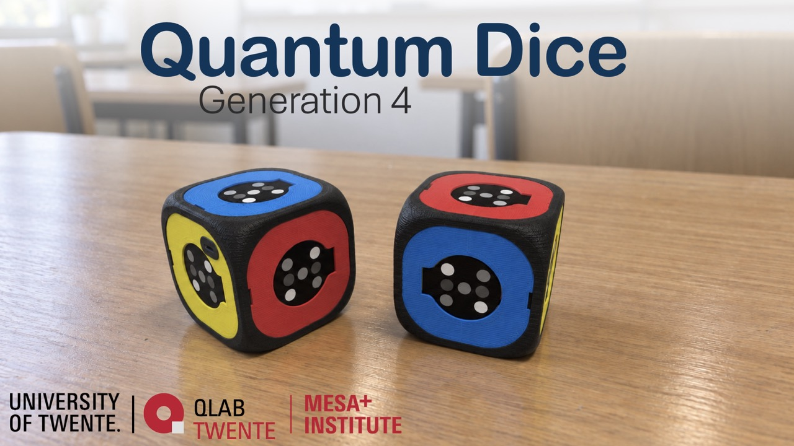
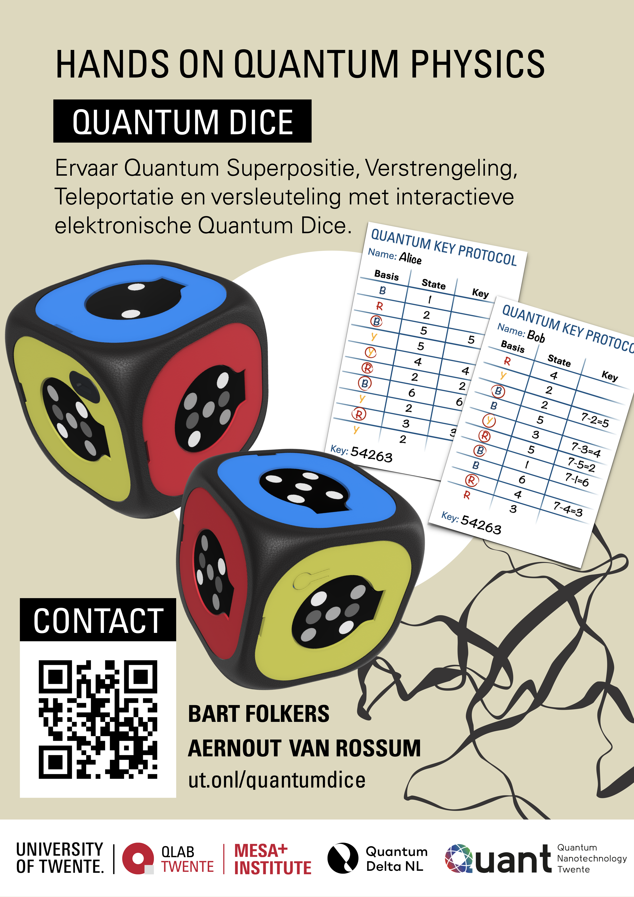

# QuantumDice by UTwente

> NEW RELEASE 📢: Quantum Dice Generation 4

We are pleased to announce that **Generation 4 of the Quantum Dice is now released on GitHub and available for ordering**!

### What's new in Generation 4?
We have been working on improving the design, functionality, and accessibility of the Quantum Dice. The latest generation introduces several important improvements:
- **Smaller and lighter design** for easier handling and classroom use
- **Cleaner, more compact appearance** that looks and feels more like a real die
- **Single-PCB design**, reducing complexity and the number of internal components
- **Screw-free Main Frame assembly**, making construction simpler and faster
- **Much quicker assembly**, with fewer parts and fewer mounting steps
- **Lower overall cost** compared with previous versions
- **Implementation of Teleportation protocol** with 3 or more Quantum Die, see [User Guide](USER_GUIDE.md).
- **Firmware changes** to create a more reliable detection of when the dice are being rolled, measured, or entangled with another die.
- Every Quantum Die can entangle with another. No need to use pairs of QD's

In this repo you can find all relevant files, including assembly instructions, 3D printing files, and the parts list. Based on this information, you can build the Quantum Dice yourself.

For further information see [Quantum Dice by University of Twente](https://www.utwente.nl/en/mesaplus/education/quantum-dice/)

You can find more information about the dice in our article, including didactical approaches, for which a preprint is available on [*arXiv*](https://arxiv.org/abs/2510.04931)

Content of this repo:
- [Construction manual](/3D%20print%20files/ConstructionManual.md) (incl. firmware)
- [Bill of Materials](/3D%20print%20files/Bill%20of%20Material%20quantum%20dice.xlsx) (incl. parts sourcing calculator)
- [3D print files](/3D%20print%20files/)
- [Firmware Source Code](/firmware/)
- [Firmware Technical documentation](/firmware/technical%20documentation.md) 

### Demo Video

Promo Video (based on generation 2)

## Contribution

Your contribution is welcome and appreciated to improve the quality and functionality of the Quantum Dice!
