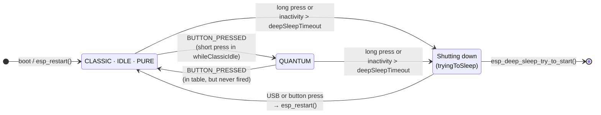
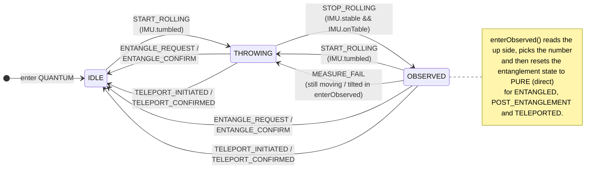
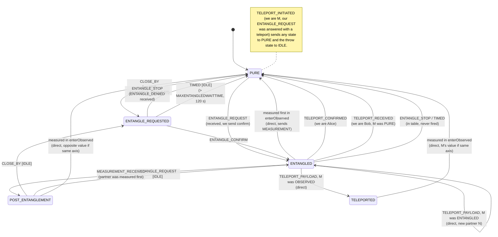

# Firmware State Machine

This document describes the state machine in [`main/StateMachine.cpp`](main/StateMachine.cpp) and [`main/StateMachine.hpp`](main/StateMachine.hpp).

The dice state is the product of three independent parts (`struct State`):

| Part | Values |
|------|--------|
| `Mode` | `CLASSIC`, `QUANTUM` |
| `ThrowState` | `IDLE`, `THROWING`, `OBSERVED` |
| `EntanglementState` | `PURE`, `ENTANGLE_REQUESTED`, `ENTANGLED`, `POST_ENTANGLEMENT`, `TELEPORTED` |

Most transitions go through `changeState(Trigger)`. It looks up the **first** matching entry in `stateTransitions`, where an empty (`std::nullopt`) current field matches any value and an empty next field leaves that value as it is. If the state changes, it calls the `onEntry` function of the new state. `update()` calls the `whileInState` function on every loop. A few transitions write `currentState.entanglementState` directly instead of using a trigger. These are drawn with dashed notes or marked *(direct)* below.

Because the full product has 16 valid states, the machine is shown as three diagrams: one for the mode and power, one for the throw state, and one for the entanglement state.

---

## 1. Mode and power

- The dice always boots into `CLASSIC / IDLE / PURE`. This state is set in the constructor, and `begin()` calls its `onEntry`.
- Watchdog broadcasts (every 500 ms) are only sent in `QUANTUM` mode, so a `CLASSIC` dice is invisible to other dice.
- Shutdown is handled in `update()` and `checkTimeForDeepSleep()`. It is outside the `State` struct, so it is not a real `State`.

---

## 2. Throw state (within `QUANTUM`)

| State | `onEntry` | `whileInState` |
|-------|-----------|----------------|
| `IDLE` | `enterQuantumIdle` | `whileQuantumIdle`: checks for a tumble and the `ENTANGLE_REQUESTED` timeout |
| `THROWING` | `enterThrowing` | `whileThrowing`: checks whether the dice is stable and on the table |
| `OBSERVED` | `enterObserved`: measures and decides the number | `whileObserved`: checks for a tumble |

The same functions are used for every entanglement state.

---

## 3. Entanglement state (within `QUANTUM`)

### Teleportation roles

| Role | Situation | What happens |
|------|-----------|--------------|
| **M** (messenger) | Comes close to dice A, which is `ENTANGLED` with B | M sends its state to B and fires `TELEPORT_INITIATED` → `PURE` |
| **A** (Alice) | Was entangled with B, receives `TELEPORT_CONFIRM` | `TELEPORT_CONFIRMED` → `PURE` |
| **B** (Bob) | Was entangled with A, receives `TELEPORT_PAYLOAD` | Takes over M's state: `PURE` (trigger), `ENTANGLED` with N (direct) or `TELEPORTED` (direct) |

When a dice that is already `ENTANGLED` comes close to another dice, `checkCloseBy()` sends a teleport request instead of firing `CLOSE_BY`.

---

## 4. Triggers and where they are fired

| Trigger | Fired from | Condition |
|---------|-----------|-----------|
| `BUTTON_PRESSED` | `whileClassicIdle` | Short button press |
| `START_ROLLING` | `whileQuantumIdle`, `whileObserved` | `IMU.tumbled()` |
| `STOP_ROLLING` | `whileThrowing` | `IMU.stable() && IMU.onTable()` |
| `MEASURE_FAIL` | `enterObserved` | Still moving, or orientation `TILTED`/`UNKNOWN` |
| `CLOSE_BY` | `checkCloseBy` | Strongest nearby dice above the RSSI limit, not entangled |
| `ENTANGLE_REQUEST` | `updateEspNow` | `ENTANGLE_REQUEST` message received (not a teleport) |
| `ENTANGLE_CONFIRM` | `updateEspNow` | `ENTANGLE_CONFIRM` message received |
| `ENTANGLE_STOP` | `updateEspNow` | `ENTANGLE_DENIED` received while `ENTANGLE_REQUESTED` |
| `MEASUREMENT_RECEIVED` | `updateEspNow` | `MEASUREMENT` message from the current partner |
| `TELEPORT_INITIATED` | `updateEspNow` | Our entangle request was answered by an entangled dice |
| `TELEPORT_CONFIRMED` | `updateEspNow` | `TELEPORT_CONFIRM` message received |
| `TELEPORT_RECEIVED` | `updateEspNow` | `TELEPORT_PAYLOAD` received, and M was `PURE` |
| `TIMED` | `whileQuantumIdle` | `ENTANGLE_REQUESTED` for longer than `MAXENTANGLEDWAITTIME` |
| `MEASURE` | — | Declared, but not used |

---

## 5. Things found while mapping the code

These are observations from reading the code, not confirmed bugs:

1. **No way back to `CLASSIC`.** The `QUANTUM → CLASSIC` transitions exist in the table, but `BUTTON_PRESSED` is only polled in `whileClassicIdle`. The only way back to `CLASSIC` is a restart after sleep.
2. **`IDLE + ENTANGLE_REQUESTED` ignores a throw.** There is no `START_ROLLING` transition for this state, so a tumble logs `"No valid state transition found"` and the dice stays where it is until it is confirmed, denied or the 120 s timeout runs out.
3. **`OBSERVED + ENTANGLE_REQUESTED` can get stuck.** You get here through `CLOSE_BY` while `OBSERVED`, or through `STOP_ROLLING` from `THROWING + ENTANGLE_REQUESTED`. There is no `START_ROLLING` transition, and `TIMED` is only checked in `whileQuantumIdle`. The dice only leaves this state through `ENTANGLE_CONFIRM` or `ENTANGLE_STOP`.
4. **Unused transitions.** `ENTANGLE_STOP` and `TIMED` from `ENTANGLED`, and the `MEASURE` trigger, are never fired.
5. **Comment does not match the table.** The comment at the `TELEPORT_RECEIVED` call says *"ENTANGLED/POST_ENTANGLEMENT -> PURE"*, but the table only defines this transition from `ENTANGLED`.
